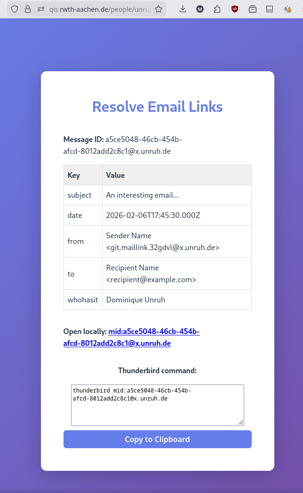

# Mail Link

Tools for creating and opening links to individual emails, e.g., to refer to an email
from a to-do list, a shared document, or a calendar entry.
A link identifies the email by its message-id and can contain additional data
(subject, date, sender, ...) for finding it when message-id search is not available.

**For user-facing information (what it does, installation, privacy), see the
[Thunderbird add-on's README](thunderbird-extension/README.md).**
The link format is specified in [this wiki page](https://github.com/dominique-unruh/mail-link/wiki/Mail%E2%80%90link-format).

<!--suppress HtmlDeprecatedAttribute -->

## Components

* [`thunderbird-extension/`](thunderbird-extension/): Thunderbird add-on
  [Copy Message Link](https://addons.thunderbird.net/en-US/thunderbird/addon/copy-message-link/),
  which creates a link for the currently opened email.
* [`webapp/`](webapp/): The landing page the links point to. It shows how to find the email
  and can open it directly in some mail clients (e.g., Thunderbird, Gmail, Apple Mail, FairEmail).
  Hosted at <https://qis.rwth-aachen.de/people/unruh/tools/mail-link/>.
* [`bookmarklet/`](bookmarklet/): Bookmarklet for creating links from webmail (currently Gmail).
* [`shared/`](shared/): Code for constructing links, shared by the components.
